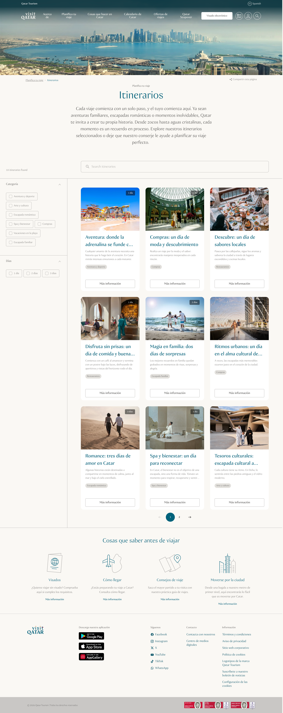

# CONTEXT — Wanderlust Explorer

Contexto permanente para agentes de IA que trabajen en este repositorio.

## 1. Proyecto

**Wanderlust Explorer** es el MVP de un explorador de experiencias de viaje. Los usuarios pueden **buscar**, **filtrar** y **guardar experiencias en favoritos**.

## 2. Stack

- Next.js (App Router)
- React
- TypeScript (modo estricto)
- Tailwind CSS

## 3. Estructura de carpetas

```
src/
├── app/         → Rutas, layouts y páginas (App Router)
├── components/  → Componentes de UI reutilizables y pequeños
├── hooks/       → Custom hooks (favoritos, búsqueda/filtros en la URL…)
├── types/       → Tipos y definiciones TypeScript compartidos
├── data/        → Datos estáticos de la app (dataset de experiencias)
└── lib/         → Utilidades y funciones puras (filtrado, helpers)
```

## 4. Datos

- Dataset: `src/data/experiences.ts` → array fijo de **100 experiencias**.
- Tipo: `src/types/experience.ts` → `Experience`.
- Usar **siempre** el tipo `Experience`; no redefinir ni duplicar su forma.

## 5. Páginas

| Ruta                | Descripción                                                           |
| ------------------- | --------------------------------------------------------------------- |
| `/`                 | Inicio: presentación de la app y acceso a explorar experiencias.      |
| `/experiences`      | Listado con búsqueda y filtros de categoría y destino.                |
| `/experiences/[id]` | Detalle de una experiencia, con opción de añadir/quitar de favoritos. |
| `/favorites`        | Experiencias guardadas en favoritos por el usuario.                   |
| `/profile`          | Perfil simulado estático que muestra el contador de favoritos guardados. |

## 6. Reglas de comportamiento

- **Búsqueda**: filtra por `title` con una regex **case-insensitive**.
- **Filtros**: categoría y destino funcionan **por separado** y se **combinan** con la búsqueda.
- **Estado en la URL**: búsqueda y filtros viven como query params, gestionados con `useSearchParams` y `usePathname`.
- **Favoritos**: se guardan en un `useState` compartido y se pasan por props o mediante custom hooks.
- **Sin resultados**: si la búsqueda o los filtros no devuelven resultados, se muestra el mensaje "No se encontraron resultados".
- **Navbar**: aparece en todas las páginas y marca el enlace activo con `usePathname`.

## 7. Restricciones

- ❌ Nada de librerías de estado externas (Redux, Zustand…).
- ❌ Nada de `localStorage`.
- ❌ Nada de `any`.
- ✅ Navegación con `Link`, sin recargas de página.
- ✅ Componentes pequeños: ningún archivo contiene toda la app.

## Design References

Fuentes: `docs/design-references/ui-muestra.png` (A: portal de experiencias, estilo editorial con contraste negro) y `docs/design-references/ui-muestra-2.png` (B: listado de itinerarios, estilo sereno y elegante).




**Base visual del proyecto = B** (paleta, tarjetas, filtros, listado). **De A** se toman los acentos: hero con imagen, bandas negras de sección, categorías circulares, mosaico y CTA en píldora.

### Tokens (Tailwind v4 → definir en `src/app/globals.css` con `@theme`)

```css
@theme {
  --color-sand: #F8F6F2;        /* fondo general de la app */
  --color-petrol: #0E5A73;      /* primario: títulos, enlaces, estado activo */
  --color-petrol-dark: #0B3B4A; /* barra superior, hover del primario */
  --color-ink: #1A1A1A;         /* bandas negras, CTA, texto fuerte */
  --color-stone: #6B6B6B;       /* texto secundario */
  --color-line: #D9D6CF;        /* bordes y separadores */
  --color-chip: #ECEAE5;        /* fondo de etiquetas */
  --color-sun: #F5C400;         /* acento puntual: rating, destacados */
  --font-display: "Cormorant Garamond", serif; /* títulos */
  --font-sans: "Lato", sans-serif;             /* cuerpo e interfaz */
}
```

Fuentes cargadas con `next/font/google` y expuestas como variables CSS.

### Colores → clases

| Uso                    | Clases                                         |
| ---------------------- | ---------------------------------------------- |
| Fondo de página        | `bg-sand`                                      |
| Superficie / tarjeta   | `bg-white`                                     |
| Títulos y enlaces      | `text-petrol hover:text-petrol-dark`           |
| Texto de cuerpo        | `text-stone`                                   |
| Bordes / divisores     | `border-line`, `divide-line`                   |
| Banda de sección / CTA | `bg-ink text-white`                            |
| Acento (rating ★)      | `text-sun`                                     |

### Tipografía

| Elemento               | Clases                                                         |
| ---------------------- | -------------------------------------------------------------- |
| H1 de página           | `font-display text-5xl md:text-6xl font-light text-petrol text-center` |
| Eyebrow sobre H1       | `text-xs uppercase tracking-widest text-stone`                 |
| Intro de página        | `max-w-2xl mx-auto text-lg leading-relaxed text-stone text-center` |
| H2 de sección          | `font-display text-3xl text-petrol`                            |
| Título de tarjeta      | `font-display text-2xl leading-snug text-petrol line-clamp-2`  |
| Cuerpo / descripción   | `text-sm leading-relaxed text-stone line-clamp-3`              |
| Meta / contador        | `text-xs text-stone`                                           |
| Título en banda (A)    | `font-display italic text-2xl md:text-3xl text-white`          |

### Componentes

- **TopBar** (B): `bg-petrol-dark text-white text-xs py-2` con marca a la izquierda y acciones a la derecha.
- **Navbar**: `flex items-center justify-between gap-8 py-4`; enlaces `text-sm hover:text-petrol`; iconos en círculo `size-10 rounded-full border border-current grid place-items-center`.
- **Hero** (A+B): `relative h-[60vh] bg-cover bg-center` + overlay `absolute inset-0 bg-gradient-to-b from-black/40 to-transparent`; título `font-display text-white text-5xl md:text-7xl`.
- **Breadcrumb**: `text-xs text-stone`; actual `text-petrol`; separador `›`.
- **SearchBar**: `w-full rounded-lg border border-line bg-white px-4 py-3 pl-11 text-sm placeholder:text-stone focus:outline-none focus:ring-2 focus:ring-petrol/30` con icono lupa a la izquierda.
- **FilterBar** (B): `w-64 border-r border-line pr-6`; grupo colapsable con título `text-sm text-ink` y chevron; separación `border-b border-line py-6`.
- **FilterChip** (checkbox): `inline-flex items-center gap-2 rounded-md border border-line px-3 py-1.5 text-xs text-stone hover:border-petrol`; activo `border-petrol text-petrol bg-petrol/5`.
- **ResultsCount**: `text-xs text-stone` («N experiencias encontradas»).
- **ExperienceGrid**: `grid gap-6 sm:grid-cols-2 lg:grid-cols-3`.
- **ExperienceCard** (B): `flex flex-col overflow-hidden rounded-xl bg-white shadow-sm hover:shadow-md transition`
  - Imagen: `aspect-[3/2] w-full object-cover`
  - Badge sobre imagen (precio): `absolute top-3 right-3 rounded bg-petrol-dark/90 px-2 py-0.5 text-xs text-white`
  - Botón favorito: `absolute top-3 left-3 size-9 rounded-full bg-white/90 grid place-items-center`
  - Cuerpo: `flex flex-1 flex-col gap-3 p-5`
  - Etiqueta categoría: `self-start rounded-full bg-chip px-2.5 py-0.5 text-[11px] text-stone`
  - Pie: `mt-auto` con botón secundario.
- **Botón primario** (A, píldora): `rounded-full bg-ink px-6 py-3 text-white font-medium hover:bg-petrol transition`.
- **Botón secundario** (B, outline): `w-full rounded-md border border-ink/70 py-2.5 text-sm text-ink hover:bg-ink hover:text-white transition`.
- **Pagination**: activo `size-10 rounded-full bg-petrol text-white grid place-items-center`; resto `text-stone hover:text-petrol`.
- **SectionBand** (A): `bg-ink py-8 flex items-center gap-6` con líneas laterales `h-px flex-1 bg-white/40` y título centrado.
- **CategoryCircle** (A, para las 5 categorías): `flex flex-col items-center gap-2`; imagen `size-24 rounded-full object-cover ring-1 ring-line`; texto `text-xs text-center text-stone`.
- **FeatureMosaic** (A, home): `grid grid-cols-2 md:grid-cols-4`, tiles `relative aspect-square overflow-hidden` con texto `absolute bottom-3 inset-x-3 text-white text-sm drop-shadow`.
- **InfoFeature** (B, iconos): `flex flex-col items-center text-center gap-3`; icono lineal `size-16 text-petrol stroke-1`; título `font-display text-xl text-petrol`; link `text-xs text-petrol underline-offset-4 hover:underline`.
- **Footer** (B): `bg-sand border-t border-line py-12 grid md:grid-cols-4 gap-8`; títulos `text-xs text-stone`; enlaces `text-sm text-petrol hover:underline`; copyright `text-xs text-stone bg-line/60 py-4`.

### Layout y estilo general

- Contenedor: `mx-auto max-w-7xl px-4 md:px-8`.
- Ritmo vertical entre secciones: `py-16 md:py-24`.
- Radios: tarjetas `rounded-xl`, inputs/chips `rounded-md`, CTA y badges circulares `rounded-full`.
- Sombras suaves (`shadow-sm` → `shadow-md` en hover), nunca duras.
- Fotografía protagonista, mucho espacio en blanco, iconos de línea fina (1px).
- Accesibilidad: foco visible `focus-visible:ring-2 focus-visible:ring-petrol`, contraste AA del texto `stone` sobre `sand`/`white`.
